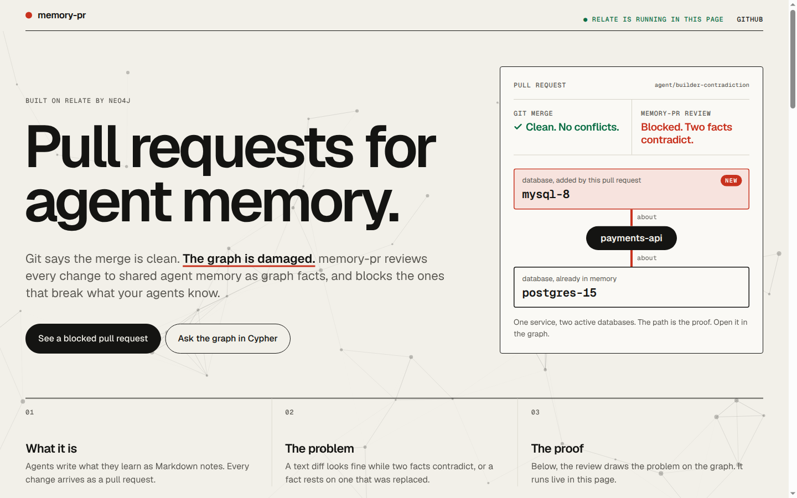

# memory-pr: pull requests for agent memory

Agents that work on the same project keep rediscovering the same things, and when they
do share notes, one wrong note quietly becomes everyone's truth.

memory-pr gives a team of agents one shared memory that is reviewed like code:

- The memory is a **graph stored as Markdown files in git** (folders are labels, notes
  are nodes, wikilinks are relationships). [Relate](https://relatedb.ai) opens that
  folder as a database, so agents read and write it in Cypher.
- Every change an agent makes arrives as a **pull request**.
- A check reads the pull request **as graph facts, not as text**, and comments what it
  adds, what it contradicts, and what the merge would silently destroy. A bad change
  cannot be merged.

Built for the [Relate by Neo4j hackathon](https://relate.devpost.com/).
[Live page](https://memory-pr.vercel.app/) · [Demo video](https://youtu.be/z1qjJQhkVJ0) ·
[Devpost](https://devpost.com/software/memory-pr-pull-requests-for-agent-memory)

## For judges

| Criterion | Where to see it |
| --- | --- |
| Relate and connected context (30) | The store is the Markdown vault [`memory/`](memory/), opened by Relate in `directory` mode; facts link to the entity they are `ABOUT`, the agent they are `ASSERTED_BY`, their `SOURCE`, and the facts they `SUPERSEDES` or are `DERIVED_FROM`. Every review rule is Cypher ([`default_rules.yaml`](src/mempr/default_rules.yaml)), run by Relate in CI, on the server and in the page (WebAssembly). [`bench/real-memory/`](bench/real-memory/) is a second store: 590 real facts from 50 public repositories. |
| Functionality and completeness (25) | A required GitHub check ([`action.yml`](action.yml)) that blocks pull requests [#15](https://github.com/himanshu748/memory-pr/pull/15) and passes [#6](https://github.com/himanshu748/memory-pr/pull/6); an [MCP server](#use-it-from-an-agent); a [backend](#backend); the [live page](https://memory-pr.vercel.app/), which reviews any public GitHub repository and can open a real pull request here. 240 tests run in CI. |
| Usefulness (20) | [On 50 popular public repositories](#measured-on-50-real-repositories), 154 of the 328 facts an agent would have learned a year ago are wrong today; the check blocks all 154 until the new fact replaces the old one. On [300 simulated pull requests](#measured-result) it cuts wrong facts left in memory from 21 to 1. |
| Documentation and reproducibility (15) | [Try it in two minutes](#try-it-in-two-minutes) (nothing to install, or `pip install -e ".[dev]" && pytest -q`); both measurements are rerun by one command each, and their raw numbers are committed in [`docs/`](docs/). |
| Creativity (10) | Agent memory reviewed the way code is: each change is a pull request, and the check reads it as a graph, so it catches damage git calls a clean merge ([why a text diff is not enough](#why-a-text-diff-is-not-enough)). |

## How it uses Relate

- **Mode: directory.** Relate opens the [`memory/`](memory) folder as a Markdown vault
  (not in memory, not a single file).
- **Why this mode:** the git-tracked Markdown notes are the database. Because the store
  is plain files in the repository, a change to the graph is a commit, and a pull request
  can review the graph before it merges. An in-memory graph has no history to review, and
  a single file would not give git one note per fact to diff and merge.
- **What the graph models:** what a team of agents knows about a project. A `Fact` is
  `ABOUT` an `Entity`, `ASSERTED_BY` an `Agent`, backed by a `SOURCE`, and can
  `SUPERSEDES` or be `DERIVED_FROM` another fact. Those relationships are what the
  review checks. The full shape is under [The graph](#the-graph).
- **Where the data lives:** [`memory/`](memory), one folder per label and one note per
  node, committed in this repository. The browser demo loads the same graph into
  Relate's WebAssembly build, in memory in the page.

## Why a text diff is not enough

Git merges text. A memory graph can be damaged by a merge git calls clean:

| What happened | Git says | The graph says |
| --- | --- | --- |
| Two agents record different databases for the same service, in two new notes | clean merge | the service now has two active values for one fact |
| An agent replaces a fact that three other facts were derived from | clean merge | three facts rest on a fact that is no longer true, up to two hops away |
| Two branches add the same property to one note on different lines | clean merge | the note has a duplicate key, Relate reads it as empty, and every link it had is gone |
| An agent links a fact to a source that was never written down | clean merge | the fact cannot be verified |

Each row is a Cypher query or a graph comparison in this repository, and each has a
test.

## Try it in two minutes

1. **Nothing to install:** open <https://memory-pr.vercel.app/>, press a starter under
   "Write a memory", then "Open pull request". The review blocks it, the fixes are one
   click each, and a passing pull request merges into the page's memory. Then press
   **Open it on GitHub**: in about half a minute your draft is a real pull request in
   this repository, with the `memory-review` comment and the required check red or
   green. It is closed again after 30 minutes ([how that is kept safe](#a-real-pull-request-from-the-page)).
2. **On GitHub:** two pull requests a scripted agent opened in this repository.
   [#15](https://github.com/himanshu748/memory-pr/pull/15) contradicts the memory, so
   `memory-review` commented and blocks the merge.
   [#6](https://github.com/himanshu748/memory-pr/pull/6) passes.
3. **On your machine:** clone, `pip install -e ".[dev]"`, then `pytest -q` and
   `mempr recall payments-api`. The full commands are under
   [Run it locally](#run-it-locally).

With write access (your own fork, for example) you can also open a new one: **Actions →
demo-agent → Run workflow**, pick a scenario (`contradiction`, `supersede`,
`stale-clone`, `unsourced` or `clean`), and a scripted agent writes to the memory on a
new branch and opens a pull request for `memory-review` to check.

## See it in the browser

**<https://memory-pr.vercel.app/>** (also at <https://himanshu748.github.io/memory-pr/>). Nothing to install.



- **Write a memory yourself.** Fill in a short form as an agent, see the Markdown note it becomes,
  and open a pull request against a copy of the memory in the page. The real rules review it, the
  fixes are one click, and a passing pull request merges into the page's memory. The same drafts are
  reviewed by `mempr check` in
  [`tests/test_playground_cases.py`](tests/test_playground_cases.py), so the page and the command
  line agree.
- **The shared memory as a graph.** Click any fact for the file it came from, the agent that wrote
  it, what it replaces and what it rests on, and the Markdown note behind it.
- **What a pull request does to it.** Five scripted pull requests, one per card: the facts each adds
  (green) and loses (red, dashed), and every problem the review found drawn on the graph, such as
  the two contradicting facts and the path between them, or the chain of derived facts resting on a
  replaced one.
- **Relate runs in the page.** The graph is loaded into Relate's WebAssembly build
  ([`@relate/relate-wasm`](https://www.npmjs.com/package/@relate/relate-wasm)), so the Cypher box
  queries it live, the review rules run in your browser, and you can write to the graph (retract a
  fact, add a contradicting one) and watch the review change. Nothing leaves the page.

The site is static with no build step and works offline: `python -m http.server -d site`, then open
<http://localhost:8000>. Its data, [`site/data/demo.json`](site/data/demo.json), comes from
`mempr export` (the graph and each review as JSON, from `mempr.vault` and `mempr.check`) and is
regenerated with `python demo/build_site.py`.

An example that is already open: [pull request 15](https://github.com/himanshu748/memory-pr/pull/15),
where the agent read an outdated design note.

Two repository settings make this work, both set once by the owner:

- **Settings → Actions → General → Workflow permissions**: tick "Allow GitHub Actions to
  create and approve pull requests", so the agent workflow can open its pull request.
- **Settings → Branches**: protect `main` and require the `memory-review` status check,
  so a blocked pull request cannot be merged.

## Measured on 50 real repositories

An agent's memory of 50 popular public GitHub repositories (Go, Rust, Python, Node and
Docker projects, from `tokio` and `fastapi` to `gitea` and `opentelemetry-demo`), learned
from their real files a year ago and compared with what the same files say today:

| | |
| --- | --- |
| Repositories read | 50 |
| Facts learned a year ago | 328 |
| Of those, wrong today | 154 (47%), in 36 repositories |
| Wrong facts the check blocked | 154 |
| Blocked after each new fact `SUPERSEDES` the old one | 0 |

Typical moves: `fastapi` now requires Python 3.11 instead of 3.8, `n8n` Node 24 instead of
22.16, `traefik` builds on Alpine 3.24 instead of 3.22. Each fact links to the file at the
commit it was read from.

Reproduce: `GITHUB_READ_TOKEN=$(gh auth token) python bench/real.py` (a few minutes; the
repositories are listed in [`bench/repos.txt`](bench/repos.txt), and the numbers change as
the repositories do). Per-repository results, with every changed value and both source
links, are in [`docs/real-repos.json`](docs/real-repos.json); the memory itself, with each
new fact superseding the stale one, is the Relate vault [`bench/real-memory/`](bench/real-memory/):

```bash
mempr --vault bench/real-memory query "MATCH (new:Fact)-[:SUPERSEDES]->(old:Fact) RETURN old.value, new.value LIMIT 5"
```

## Measured result

300 pull requests from simulated agents (5 seeds, 10 rounds, 6 agents per round,
30% of pull requests carry one of four mistakes), replayed with and without the check.
At the end a new agent asks the memory about every service.

| | Without the check | With the check |
| --- | --- | --- |
| Pull requests merged | 299 | 254 |
| Pull requests blocked | 0 | 46 |
| Pull requests fixed after the review, then merged | 0 | 8 |
| Correct pull requests blocked by mistake | 0 | 0 |
| Wrong facts in memory at the end | 21 | 1 |
| Contradictions in memory | 25 | 0 |
| Facts resting on a replaced fact | 8 | 0 |
| Notes emptied by a merge git called clean | 3 | 0 |
| Facts with no source | 20 | 0 |
| Questions answered correctly (of 240) | 139 | 160 |
| Questions answered wrongly or with two values | 19 | 1 |

Reproduce: `python bench/run.py --seed 1 --seeds 5 --rounds 10 --agents 6 --out docs/benchmark.json`
(about 2 minutes). The agents, the project and its ground truth are generated in
[`bench/run.py`](bench/run.py); raw numbers are in [`docs/benchmark.json`](docs/benchmark.json).
The questions left unanswered in both columns are facts no agent was asked to learn.
The one wrong fact that remains with the check is a true change whose pull request
stayed blocked, so the memory still holds the older value.

## Run it locally

Requires Python 3.10+ and git 2.38+.

```bash
git clone https://github.com/himanshu748/memory-pr && cd memory-pr
python -m venv .venv && . .venv/bin/activate
pip install -e ".[dev]"
pytest -q

# Ask the memory something (current facts only, each with its source)
mempr recall payments-api

# Any Cypher, straight on the Markdown files
mempr query "MATCH p = (f:Fact)-[:DERIVED_FROM*]->(r:Fact {name: 'payments-api--database--postgres-15'}) RETURN f.name AS fact, length(p) AS hops"

# Let an agent make a bad change on a branch, then review it
python demo/agent.py run --scenario contradiction
mempr check --base origin/main --head HEAD
```

### Inspect the store with Relate directly

The store is the `memory/` folder. With the [Relate CLI](https://relatedb.ai):

```bash
relate --snapshot-format markdown --database memory \
  "MATCH (f:Fact)-[:ABOUT]->(e:Entity) RETURN e.name, f.predicate, f.value"
```

Relate writes its own state to `memory/.relate/` and regenerates `index.md` files; both
are git-ignored because the notes are the durable store.

## The graph

```
(:Fact {predicate, value, status})-[:ABOUT]->(:Entity)
(:Fact)-[:ASSERTED_BY]->(:Agent)
(:Fact)-[:SOURCE]->(:Source {uri})
(:Fact)-[:SUPERSEDES]->(:Fact)
(:Fact)-[:DERIVED_FROM]->(:Fact)
(:Predicate {cardinality})          # optional: `many` allows several values
```

A fact is one note, for example `memory/Fact/payments-api--database--postgres-15.md`:

```markdown
---
type: Fact
name: payments-api--database--postgres-15
predicate: database
status: active
value: postgres-15
ABOUT:
  - "[[Entity/payments-api]]"
ASSERTED_BY:
  - "[[Agent/scout]]"
SOURCE:
  - "[[Source/demo-project-services-payments-api-service-yaml]]"
---

payments-api database: postgres-15
```

## What the check does

`mempr check --base <branch> --head <revision>`:

1. Loads four versions of the graph with Relate: the common ancestor, the base branch,
   the pull request, and the result of git's merge (`git merge-tree`, nothing is checked
   out).
2. Reports the pull request as added and removed graph facts.
3. Merges the two graphs itself and compares that with git's merge. A fact that neither
   side removed but that is missing after the merge is reported as dropped. A property
   both sides set to different values is reported as a conflict.
4. Runs the review rules, which are Cypher queries, on the merged graph and reports only
   the findings the pull request introduces.
5. Exits 1 when anything blocks, so a required status check stops the merge; exits 2
   when the review itself cannot run (for example, no common ancestor between the
   branches).

Rules live in [`src/mempr/default_rules.yaml`](src/mempr/default_rules.yaml). Add your
own in `memory-rules.yaml` at the repository root; a rule is an id, a severity (`block`
or `warn`), a message template, and a Cypher query whose rows are the findings. The
check reads that file from the base branch, so a pull request cannot change the rules
it is reviewed with.

| Rule | Blocks | Finds |
| --- | --- | --- |
| `contradiction` | yes | two current facts giving one entity different values for one predicate |
| `stale-derivation` | yes | an active fact derived, up to 6 hops away, from a retracted or replaced fact |
| `supersedes-cycle` | yes | facts that replace each other in a circle, so none is current |
| `dangling-link` | yes | a link to a note that does not exist |
| `unsourced-fact` | yes | an active fact with no source |
| `unattributed-fact` | no | a fact with no author |

## Use it from an agent

`mempr mcp` is an [MCP](https://modelcontextprotocol.io) server over stdio, so Claude Code,
Cursor, Devin or any other MCP client can use the memory while it works. Add it to the
client's MCP config (`.mcp.json` for Claude Code, `.cursor/mcp.json` for Cursor), with the
path of the repository that holds `memory/`:

```json
{
  "mcpServers": {
    "memory": {
      "command": "uvx",
      "args": [
        "--from", "git+https://github.com/himanshu748/memory-pr",
        "mempr", "--repo", "/absolute/path/to/your/repo", "mcp"
      ]
    }
  }
}
```

With `mempr` already installed, the command is `mempr --repo /absolute/path/to/your/repo mcp`
(Claude Code: `claude mcp add memory -- mempr --repo "$PWD" mcp`).

| Tool | What the agent gets |
| --- | --- |
| `recall` | The current facts about an entity, each with its sources and authors. For an entity the memory does not know, the answer is "Nothing known ... Do not guess", not an empty list to fill in. |
| `query` | The rows of a read-only Cypher query. Writing clauses are refused, and the query runs on a throwaway copy of the files. |
| `propose_fact` | One fact, written with `mempr.memory.add_fact` and committed on a new branch, plus the review of that branch. `open_pull_request: true` also pushes it and opens the pull request with `gh`. |
| `retract_fact` | The same for a retraction. |
| `review` | The review of any branch against a base: the result of `mempr check` as JSON, and the comment text. |

An agent cannot write to the memory directly. A proposal is committed on an `agent/*`
branch in a temporary git worktree, so the branch you have checked out, your working tree and `main` do not move.
When the review blocks a proposal, the agent reads why and sends the fix with the same
`branch`; the fact becomes shared memory only when the pull request is merged.
`--base` sets the branch proposals start from and are reviewed against (default
`origin/main`).

### A skill for coding agents

[`.claude/skills/memory-pr/SKILL.md`](.claude/skills/memory-pr/SKILL.md) is an
[Agent Skill](https://agentskills.io) that teaches a coding agent the habit: recall before
assuming, never edit `memory/` on the main branch, propose every fact with its source on
a branch, and fix what the review blocks. It works with the MCP server or with the plain
`mempr` commands. Copy the folder into your repository's `.claude/skills/` (Claude Code)
or wherever your agent reads skills from.

## Use it in your own repository

1. Keep your memory as Markdown notes under `memory/` (or pass `vault:`), one note per
   fact, in the [shape above](#the-graph). `mempr add-fact` writes them.
2. Add this workflow as `.github/workflows/memory-review.yml`:

   ```yaml
   name: memory-review
   on: pull_request
   permissions:
     contents: read
     pull-requests: write
   jobs:
     memory-review:
       runs-on: ubuntu-latest
       steps:
         - uses: actions/checkout@v4
           with:
             fetch-depth: 0
         - uses: himanshu748/memory-pr@v1
   ```

   The action installs `mempr`, reviews the pull request against its base branch, posts
   the review as one comment that it keeps up to date, and fails when the merge would
   damage the graph. Inputs: `base`, `head`, `vault`, `rules` (an extra rules file, read
   from the base branch), `comment` and `python-version`.
3. In the branch protection for your main branch, require the `memory-review` check.

This repository's own [`memory-review.yml`](.github/workflows/memory-review.yml) does the
same steps by hand, because it also installs `mempr` from the base branch and reviews
pull requests that the Actions token opened.

## How Relate is used

- **Markdown vault store**: the git-tracked notes are the database. There is no import
  step and no second copy of the data.
- **Cypher** for every read and write: recall, fact writes (`MERGE`), all review rules,
  including the variable-length `DERIVED_FROM*1..6` path query.
- **Embedded Python library** (`relate-db`), inside the CLI, the MCP server and the GitHub
  Action.
- **WebAssembly build** (`@relate/relate-wasm`) in the browser view, running the same review
  rules on the same graph in the page.
- **The same library in a serverless function**: the backend opens a copy of the committed
  vault per request and runs the review on it.

## Try it on a real repository

The sample memory is made up; this part is not. Under "Point it at a real repository" on
<https://memory-pr.vercel.app/>, name any public GitHub repository. Agent `scout` reads it
at the last commit before a date months ago and agent `builder` reads today's head. Each
writes what the files state as notes (the final `FROM` of each Dockerfile, `engines` and
`packageManager` in package.json, the `go` line of go.mod, `requires-python`, Cargo's
`rust-version` and `edition`, `.nvmrc`, `.python-version`), each fact linked to its
`Source`: the file's URL at that commit. The review then runs the same Cypher rules as
every pull request. Every value that moved is a `contradiction`, with both files linked,
until the new fact says it `SUPERSEDES` the old one; the page shows both reviews and opens
either in the graph explorer, where Relate in the page reruns the rules.

On `GoogleCloudPlatform/microservices-demo` a year back it finds about a dozen moved values, such as
the checkout service going from Go 1.23.0 to 1.25.0. The same works from Python:

```python
from mempr.realrepo import learn
from mempr.rules import load_rules

result = learn("tokio-rs/tokio", 12, load_rules(None))
print(result["blocked"], [(c["entity"], c["old"], c["new"]) for c in result["changed"]])
```

## Backend

The page works with no server. On <https://memory-pr.vercel.app/> it also has one: Python
functions under [`api/`](api/) that run the same `mempr` code as the command line, with
Relate embedded. Each request copies the committed `memory/` folder to a temporary
directory and works there, so the server never writes to the repository and keeps nothing
between requests.

| Endpoint | What it does |
| --- | --- |
| `GET /api/health` | Opens the memory with Relate and returns the fact count and the Relate version. |
| `POST /api/review` | Reviews one draft change against the committed memory and returns the verdict, the findings and the comment `memory-review` would post. |
| `GET /api/recall?entity=` | The current facts about one entity, each with its sources and the agents that asserted it. Replaced and retracted facts are left out. |
| `POST /api/query` | Runs a read-only Cypher query on the committed memory and returns the rows. |
| `GET /api/learn?repo=owner/name&months=12` | Reads a real public repository on GitHub at a commit from that many months ago and at today's head, writes what each reading states as two memories, and reviews the newer one against the older. Read-only, keeps nothing. |
| `POST /api/pull-requests` | Asks GitHub to open one draft as a real pull request. `GET /api/pull-requests/<id>` says where it stands. |

```bash
curl -s https://memory-pr.vercel.app/api/health

curl -s https://memory-pr.vercel.app/api/review \
  -H 'Content-Type: application/json' \
  -d '{"draft": {"agent": "visitor", "entity": "payments-api", "predicate": "database",
       "value": "mysql-8", "source": "docs/design.md"}}'
# {"blocked": true, "problems": 1, "rules": ["contradiction"], "review": {...}, "comment": "## Memory review: blocked ..."}
```

A draft has the shape of the ones in
[`site/data/playground-cases.json`](site/data/playground-cases.json): `agent`, `entity`,
`predicate`, `value`, optional `source`, `supersedes` and `retract`, or
`{"kind": "retract", "target": "<fact name>"}`. `merged` is an optional list of earlier
drafts to apply first, which is how the page has the server review a draft against what
the visitor already merged in the tab. The review does not need git:
`mempr.check.review_vaults` compares two vault folders, and `mempr check` uses the same
code for the trees it reads from git.

After the page reviews a draft itself, it sends the same draft to `/api/review` and shows
whether the server agrees. If there is no server (a local copy, or the request fails) that
line is not shown and nothing else changes.

`/api/recall` and `/api/query` are the memory over HTTP, for an agent that cannot run the
MCP server:

```bash
curl -s 'https://memory-pr.vercel.app/api/recall?entity=payments-api'
# {"entity": "payments-api", "known": true, "fact_count": 7, "truncated": false,
#  "facts": [{"fact": "payments-api--database--postgres-15", "predicate": "database",
#             "value": "postgres-15", "statement": "...", "sources": [...], "agents": [...]}, ...]}

curl -s https://memory-pr.vercel.app/api/query \
  -H 'Content-Type: application/json' \
  -d '{"cypher": "MATCH (f:Fact)-[:ABOUT]->(e:Entity {name: $entity}) RETURN f.predicate AS predicate, f.value AS value, f.status AS status",
       "params": {"entity": "payments-api"}}'
# {"rows": [{"predicate": "database", "value": "postgres-15", "status": "active"}, ...],
#  "row_count": 7, "truncated": false}
```

`/api/query` uses the same read-only check as the MCP server's `query` tool: a query with
`CREATE`, `MERGE`, `SET`, `DELETE`, `REMOVE`, `DROP`, `FOREACH`, `INSERT` or `LOAD CSV`
gets a 403, and so does a `CALL` of any procedure outside a short list that only reads
(`db.labels`, `db.relationshipTypes`, `db.propertyKeys`, the `db.schema` procedures and the
index queries), because Relate also ships procedures that write. Each query runs on a
throwaway copy of the memory, never the deployed files, in a separate process limited to
512 MB of memory and 3 seconds. A query that needs more is stopped with a 422 or a 408 and
the server carries on. A query may be 2,000 characters, `params` values must be text,
numbers, true, false or null, and the answer holds the first 200 rows (`truncated` says
whether there were more) and at most 256 KB (413). `/api/recall` returns up to 100 facts.

### A real pull request from the page

On the Vercel page, a draft that has been reviewed gets an **Open it on GitHub** button.
It opens the draft as a real pull request in this repository, where `memory-review`
comments and sets its check, so a visitor can watch a contradiction get blocked on GitHub
itself.

The server never writes to the repository. It checks the draft, then starts the
[`playground-agent`](.github/workflows/playground-agent.yml) workflow with a token that
can only start and read workflow runs in this one repository. The workflow, as
`github-actions[bot]`, checks the draft again with the same code, writes the note with
`mempr`, pushes `playground/<id>`, opens a pull request labelled `playground` and starts
`memory-review` on it.

```bash
curl -s https://memory-pr.vercel.app/api/pull-requests
# {"enabled": true, "limit": 3, "daily": 20, "minutes": 30}

curl -s https://memory-pr.vercel.app/api/pull-requests \
  -H 'Content-Type: application/json' \
  -d '{"draft": {"agent": "visitor", "entity": "payments-api", "predicate": "database",
       "value": "mysql-8", "source": "docs/design.md"}}'
# {"id": "3f9c2a71b0", "branch": "playground/3f9c2a71b0", "state": "queued",
#  "expected": {"blocked": true, "rules": ["contradiction"]}}

curl -s https://memory-pr.vercel.app/api/pull-requests/3f9c2a71b0
# {"id": "3f9c2a71b0", "state": "open", "number": 41, "url": "https://github.com/...",
#  "check": "failure", "check_url": "...", ...}
```

The guards:

- A draft for GitHub is a new fact whose agent, entity, predicate and value are short
  lowercase words (letters, digits, `.` and `-`, 60 characters) and whose source is a
  lowercase path. The server refuses anything else, and the workflow refuses it again.
- The workflow receives the values as environment variables. None is ever part of a
  command.
- At most three playground pull requests are open at once, and at most 20 are opened in
  any 24 hours. The workflow decides; the server checks first to give a clear answer (429).
- Runs of the workflow go one at a time, so two requests cannot both take the last place,
  and the server sends nothing while a run is unfinished (429).
- [`playground-cleanup`](.github/workflows/playground-cleanup.yml) closes playground pull
  requests older than 30 minutes and deletes their branches. It is scheduled every ten
  minutes, but GitHub can start a schedule hours late, so each pull request also books its
  own cleanup run for 31 minutes after it opens, and the `playground-agent` workflow
  closes expired ones before it counts.
- Vercel builds no deployment for `playground/*` branches (`vercel.json`).
- Where the token is not set (preview deployments, a local copy) the endpoint answers
  503 "not enabled" and the page does not show the button.

`state` is `queued`, `open`, `closed`, `failed` (the workflow refused) or `unknown`, and
`check` is `pending`, `success`, `failure`, `error` or `unknown`. The server reads pull
request and check state from GitHub's public API with no token; when GitHub limits those
calls it answers `unknown` with a link to look on GitHub instead of an error.

Limits: request bodies up to 16 KB, at most 12 earlier drafts, names and values checked
before anything is written, values passed to Cypher as parameters. Errors are JSON with a
status code (400 malformed, 413 too large, 422 not a valid draft). Other sites cannot call
it from a browser, apart from this project's GitHub Pages mirror.

## Data and disclosures

- The sample project under `demo/project/` and the memory under `memory/` are generated
  and fictional. "Point it at a real repository" reads real public files from GitHub when
  you ask it to, and stores nothing. Nothing was recorded; there is no voice or video.
- The demo agents are scripted and call no model.
- Built with AI assistance (Devin). Third-party: Relate (`relate-db`, `@relate/relate-wasm`),
  PyYAML, the MCP Python SDK, Cytoscape.js (graph drawing in the browser view), the Geist and
  Geist Mono fonts (self-hosted, SIL Open Font License), pytest, ruff. The browser view is a
  static page hosted on Vercel and GitHub Pages.
- The backend sets no cookies, has no analytics and no accounts, and its code does not log
  request bodies or addresses. A draft sent for review is used for that one response and
  then discarded.
- A draft opened with **Open it on GitHub** becomes a public pull request in this
  repository, written by `github-actions[bot]`. It holds only the short lowercase words of
  the draft, nothing about the visitor, and is closed after 30 minutes.

## License

MIT
