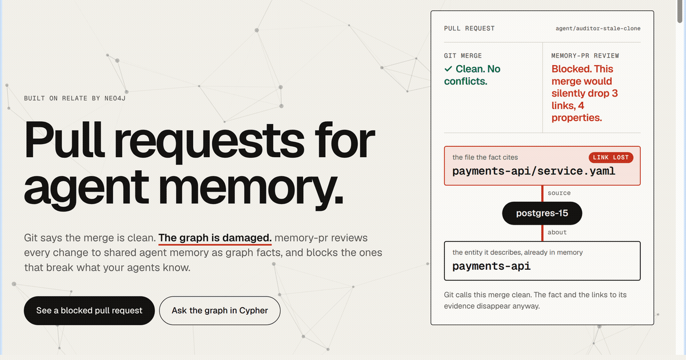

# memory-pr

**A text diff can't show what a memory change breaks.**

Agents that share a project keep rediscovering the same things — and one wrong note
quietly becomes everyone's truth. memory-pr gives them one shared memory, reviewed
like code: the memory is a **graph stored as Markdown in git** (Relate opens the
folder as a database), every change arrives as a **pull request**, and `mempr check`
reviews the PR as graph facts — blocking contradictions, unsourced facts, and merges
that silently drop links.



[Live page](https://memory-pr.vercel.app/) ·
[Demo video](https://youtu.be/z1qjJQhkVJ0) ·
[Devpost](https://devpost.com/software/memory-pr-pull-requests-for-agent-memory) ·
Built for the [Relate by Neo4j hackathon](https://relate.devpost.com/)

## Try it

One command from a fresh clone — prerequisite: Python 3.10+ only.

```bash
./quickstart.sh
```

It serves the playground and opens the graph view in your browser: write a memory,
open a pull request, watch the review block it. No credentials, no env vars, no
install. Verified from a fresh clone — output in [docs/EVIDENCE.md](docs/EVIDENCE.md).

Beside it, on GitHub: a blocked pull request
[#15](https://github.com/himanshu748/memory-pr/pull/15) (contradiction caught by the
required `memory-review` check) and a passing one
[#6](https://github.com/himanshu748/memory-pr/pull/6).

## What Relate does here

| Relate feature | The user-visible thing it enables | Implementation |
| --- | --- | --- |
| Cypher over the Markdown vault | `mempr recall` / `mempr query` / `mempr check` — every read and every review rule is a Cypher query on the git-tracked notes | [`src/mempr/default_rules.yaml`](src/mempr/default_rules.yaml), [`src/mempr/check.py`](src/mempr/check.py) |
| Variable-length `DERIVED_FROM` paths | the `stale-derivation` rule: a fact resting on a replaced fact up to 6 hops away is caught | [`default_rules.yaml` (query)](src/mempr/default_rules.yaml) |
| WASM (`@relate/relate-wasm`) | the same rules plus a writable Cypher console run in the browser page — nothing leaves the tab | [`site/index.html`](site/index.html), [`site/app.js`](site/app.js) |
| Embedded Python (`relate-db`) | the CLI, the MCP server, the GitHub Action and the serverless backend all open the vault with the same engine | [`src/mempr/vault.py`](src/mempr/vault.py), [`api/`](api/) |
| MCP | agents get `recall`/`query` reads and `propose_fact`/`retract_fact`/`review` writes on the Relate-backed memory — writes land on a branch for the check, never on `main` | [`src/mempr/mcp_server.py`](src/mempr/mcp_server.py), [docs/agents.md](docs/agents.md) |

## Evidence

- **Real agent run (A/B).** Same fixture, same prompt, same model — only the seeded
  memory differed. Stale memory → `postgres:15` and a memory proposal the check
  blocked ([PR #1](https://github.com/himanshu748/memory-pr-ab-fixture/pull/1));
  reviewed memory → `mongo:8` and a proposal that passed
  ([PR #2](https://github.com/himanshu748/memory-pr-ab-fixture/pull/2)). Prompts,
  diffs, and check output: [docs/EVIDENCE.md](docs/EVIDENCE.md),
  [demo/ab/RUNBOOK.md](demo/ab/RUNBOOK.md).
- **50 real repositories:** 154 of the 328 facts learned a year ago are wrong today;
  the check blocks all 154 until superseded —
  [docs/real-repos.json](docs/real-repos.json), details in
  [docs/benchmarks.md](docs/benchmarks.md):

  | | |
  | --- | --- |
  | Repositories read | 50 |
  | Wrong facts blocked, then 0 once superseded | 154 |
- **300-PR replay (simulated):** wrong facts left in memory 21 → 1, zero correct PRs
  blocked — [docs/benchmark.json](docs/benchmark.json), details in
  [docs/benchmarks.md](docs/benchmarks.md).
- **253 tests** pass on `pytest -q` (run 25 Nov 2026 on the release branch); the 13
  JavaScript tests run `node --test tests/js`.

## Docs

- [How it works](docs/how-it-works.md) — the vault schema, the six review rules, why a
  text diff is not enough, Relate's `directory` mode
- [Try it / backend](docs/usage.md) — the browser playground, real repositories, the
  API, and how a page draft becomes a real GitHub PR
- [Use it from an agent](docs/agents.md) — `mempr setup`, the MCP tools, the skill,
  and the composite Action for your own repo — plus the judge's scorecard map
- [Benchmarks](docs/benchmarks.md) · [Evidence log](docs/EVIDENCE.md) ·
  [90-second video script](docs/VIDEO.md)

## Disclosures

- Built entirely during the contest (started Nov 20, 2026); no code reused from earlier projects.
- Built with AI assistance (Devin). Third-party: Relate (`relate-db`,
  `@relate/relate-wasm`), PyYAML, the MCP Python SDK, Cytoscape.js, the Geist and Geist
  Mono fonts, pytest, ruff.
- The sample project and the scripted demo agents are fictional; the real-repository
  scan reads public files on request and stores nothing. The backend sets no cookies,
  has no accounts, keeps no state between requests.
- License: [MIT](LICENSE).
