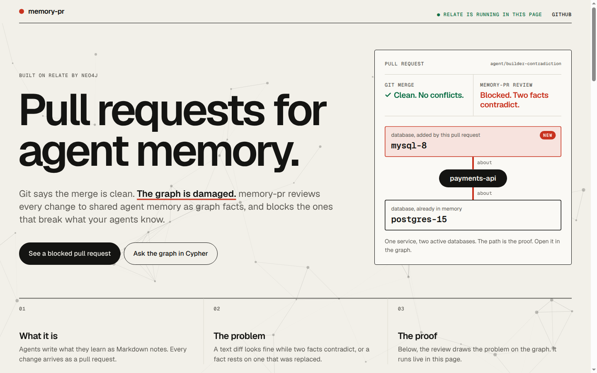

# Try it, run it, and the backend

[Back to README](../README.md)

## Try it in two minutes

1. **Nothing to install:** open <https://memory-pr.vercel.app/>, press a starter under
   "Write a memory", then "Open pull request". The review blocks it, the fixes are one
   click each, and a passing pull request merges into the page's memory. Then press
   **Open it on GitHub**: in about half a minute your draft is a real pull request in
   this repository, with the `memory-review` comment and the required check red or
   green. It is closed again after 30 minutes ([how that is kept safe](#a-real-pull-request-from-the-page)).
2. **On GitHub:** two pull requests a scripted agent opened in this repository.
   [#15](https://github.com/himanshu748/memory-pr/pull/15) contradicts the memory, so
   `memory-review` commented and blocks the merge.
   [#6](https://github.com/himanshu748/memory-pr/pull/6) passes.
3. **On your machine:** clone, `pip install -e ".[dev]"`, then `pytest -q` and
   `mempr recall payments-api`. The full commands are under
   [Run it locally](#run-it-locally).

With write access (your own fork, for example) you can also open a new one: **Actions →
demo-agent → Run workflow**, pick a scenario (`contradiction`, `hop`, `supersede`,
`stale-clone`, `unsourced` or `clean`), and a scripted agent writes to the memory on a
new branch and opens a pull request for `memory-review` to check.

## See it in the browser

**<https://memory-pr.vercel.app/>** (also at <https://himanshu748.github.io/memory-pr/>). Nothing to install.



- **Write a memory yourself.** Fill in a short form as an agent, see the Markdown note it becomes,
  and open a pull request against a copy of the memory in the page. The real rules review it, the
  fixes are one click, and a passing pull request merges into the page's memory. The same drafts are
  reviewed by `mempr check` in
  [`tests/test_playground_cases.py`](../tests/test_playground_cases.py), so the page and the command
  line agree.
- **The shared memory as a graph.** Click any fact for the file it came from, the agent that wrote
  it, what it replaces and what it rests on, and the Markdown note behind it.
- **What a pull request does to it.** Five scripted pull requests, one per card: the facts each adds
  (green) and loses (red, dashed), and every problem the review found drawn on the graph, such as
  the two contradicting facts and the path between them, or the chain of derived facts resting on a
  replaced one.
- **Relate runs in the page.** The graph is loaded into Relate's WebAssembly build
  ([`@relate/relate-wasm`](https://www.npmjs.com/package/@relate/relate-wasm)), so the Cypher box
  queries it live, the review rules run in your browser, and you can write to the graph (retract a
  fact, add a contradicting one) and watch the review change. Nothing leaves the page.

The site is static with no build step and works offline: `python -m http.server -d site`, then open
<http://localhost:8000>. Its data, [`site/data/demo.json`](../site/data/demo.json), comes from
`mempr export` (the graph and each review as JSON, from `mempr.vault` and `mempr.check`) and is
regenerated with `python demo/build_site.py`.

An example that is already open: [pull request 15](https://github.com/himanshu748/memory-pr/pull/15),
where the agent read an outdated design note.

Two repository settings make this work, both set once by the owner:

- **Settings → Actions → General → Workflow permissions**: tick "Allow GitHub Actions to
  create and approve pull requests", so the agent workflow can open its pull request.
- **Settings → Branches**: protect `main` and require the `memory-review` status check,
  so a blocked pull request cannot be merged.

## Try it on a real repository

The sample memory is made up; this part is not. Under "Point it at a real repository" on
<https://memory-pr.vercel.app/>, name any public GitHub repository. Agent `scout` reads it
at the last commit before a date months ago and agent `builder` reads today's head. Each
writes what the files state as notes (the final `FROM` of each Dockerfile, `engines` and
`packageManager` in package.json, the `go` line of go.mod, `requires-python`, Cargo's
`rust-version` and `edition`, `.nvmrc`, `.python-version`), each fact linked to its
`Source`: the file's URL at that commit. The review then runs the same Cypher rules as
every pull request. Every value that moved is a `contradiction`, with both files linked,
until the new fact says it `SUPERSEDES` the old one; the page shows both reviews and opens
either in the graph explorer, where Relate in the page reruns the rules.
Older facts with no value in the latest scan are marked `unconfirmed` in both proposed
graphs. The result keeps the original source link and says whether the file was removed,
outside the scan limits, or read without finding the value.

On `GoogleCloudPlatform/microservices-demo` a year back it finds about a dozen moved values, such as
the checkout service going from Go 1.23.0 to 1.25.0. The same works from Python:

```python
from mempr.realrepo import learn
from mempr.rules import load_rules

result = learn("tokio-rs/tokio", 12, load_rules(None))
print(result["blocked"], [(c["entity"], c["old"], c["new"]) for c in result["changed"]])
```

## Run it locally

No Docker. No API key. Python 3.10+, git 2.38+, and Node 18+ for the JavaScript tests.
The playground itself is [`quickstart.sh`](../quickstart.sh): Python's standard-library
HTTP server, nothing to install.

```bash
git clone https://github.com/himanshu748/memory-pr && cd memory-pr
./quickstart.sh                       # playground in the browser

node --test tests/js/*.test.mjs       # 13 tests, no npm install
./test.sh                             # creates .venv, installs, runs both suites

# or, if you already have a virtualenv:
pip install -e ".[dev]"
pytest -q                             # runs the JS tests too when node is on PATH

# Ask the memory something (current facts only, each with its source)
mempr recall payments-api

# Keyword, then the facts up to 6 hops along DERIVED_FROM. No model.
mempr search postgres

# Any Cypher, straight on the Markdown files
mempr query "MATCH p = (f:Fact)-[:DERIVED_FROM*]->(r:Fact {name: 'payments-api--database--postgres-15'}) RETURN f.name AS fact, length(p) AS hops"

# Let an agent make a bad change on a branch, then review it
python demo/agent.py run --scenario hop
mempr check --base origin/main --head HEAD
```

`mempr search` matches entity names, predicates, values, statements and source paths,
then walks `DERIVED_FROM`. Searching for `postgres` also returns the restore drill two
hops away. `mempr search --json` includes the two Cypher queries. The page's search box
runs the same queries in Relate's WebAssembly build.

## Backend

The page works with no server. On <https://memory-pr.vercel.app/> it also has one: Python
functions under [`api/`](../api/) that run the same `mempr` code as the command line, with
Relate embedded. Each request copies the committed `memory/` folder to a temporary
directory and works there, so the server never writes to the repository and keeps nothing
between requests.

| Endpoint | What it does |
| --- | --- |
| `GET /api/health` | Opens the memory with Relate and returns the fact count and the Relate version. |
| `POST /api/review` | Reviews one draft change against the committed memory and returns the verdict, the findings and the comment `memory-review` would post. |
| `GET /api/recall?entity=` | The current facts about one entity, each with its sources and the agents that asserted it. Replaced and retracted facts are left out. |
| `POST /api/query` | Runs a read-only Cypher query on the committed memory and returns the rows. |
| `GET /api/learn?repo=owner/name&months=12` | Reads a real public repository on GitHub at a commit from that many months ago and at today's head, writes what each reading states as two memories, and reviews the newer one against the older. Read-only, keeps nothing. |
| `POST /api/pull-requests` | Asks GitHub to open one draft as a real pull request. `GET /api/pull-requests/<id>` says where it stands. |

```bash
curl -s https://memory-pr.vercel.app/api/health

curl -s https://memory-pr.vercel.app/api/review \
  -H 'Content-Type: application/json' \
  -d '{"draft": {"agent": "visitor", "entity": "payments-api", "predicate": "database",
       "value": "mysql-8", "source": "docs/design.md"}}'
# {"blocked": true, "problems": 1, "rules": ["contradiction"], "review": {...}, "comment": "## Memory review: blocked ..."}
```

A draft has the shape of the ones in
[`site/data/playground-cases.json`](../site/data/playground-cases.json): `agent`, `entity`,
`predicate`, `value`, optional `source`, `supersedes` and `retract`, or
`{"kind": "retract", "target": "<fact name>"}`. `merged` is an optional list of earlier
drafts to apply first, which is how the page has the server review a draft against what
the visitor already merged in the tab. The review does not need git:
`mempr.check.review_vaults` compares two vault folders, and `mempr check` uses the same
code for the trees it reads from git.

After the page reviews a draft itself, it sends the same draft to `/api/review` and shows
whether the server agrees. If there is no server (a local copy, or the request fails) that
line is not shown and nothing else changes.

`/api/recall` and `/api/query` are the memory over HTTP, for an agent that cannot run the
MCP server:

```bash
curl -s 'https://memory-pr.vercel.app/api/recall?entity=payments-api'
# {"entity": "payments-api", "known": true, "fact_count": 7, "truncated": false,
#  "facts": [{"fact": "payments-api--database--postgres-15", "predicate": "database",
#             "value": "postgres-15", "statement": "...", "sources": [...], "agents": [...]}, ...]}

curl -s https://memory-pr.vercel.app/api/query \
  -H 'Content-Type: application/json' \
  -d '{"cypher": "MATCH (f:Fact)-[:ABOUT]->(e:Entity {name: $entity}) RETURN f.predicate AS predicate, f.value AS value, f.status AS status",
       "params": {"entity": "payments-api"}}'
# {"rows": [{"predicate": "database", "value": "postgres-15", "status": "active"}, ...],
#  "row_count": 7, "truncated": false}
```

`/api/query` uses the same read-only check as the MCP server's `query` tool: a query with
`CREATE`, `MERGE`, `SET`, `DELETE`, `REMOVE`, `DROP`, `FOREACH`, `INSERT` or `LOAD CSV`
gets a 403, and so does a `CALL` of any procedure outside a short list that only reads
(`db.labels`, `db.relationshipTypes`, `db.propertyKeys`, the `db.schema` procedures and the
index queries), because Relate also ships procedures that write. Each query runs on a
throwaway copy of the memory, never the deployed files, in a separate process limited to
512 MB of memory and 3 seconds. A query that needs more is stopped with a 422 or a 408 and
the server carries on. A query may be 2,000 characters, `params` values must be text,
numbers, true, false or null, and the answer holds the first 200 rows (`truncated` says
whether there were more) and at most 256 KB (413). `/api/recall` returns up to 100 facts.

### A real pull request from the page

On the Vercel page, a draft that has been reviewed gets an **Open it on GitHub** button.
It opens the draft as a real pull request in this repository, where `memory-review`
comments and sets its check, so a visitor can watch a contradiction get blocked on GitHub
itself.

The server never writes to the repository. It checks the draft, then starts the
[`playground-agent`](../.github/workflows/playground-agent.yml) workflow with a token that
can only start and read workflow runs in this one repository. The workflow, as
`github-actions[bot]`, checks the draft again with the same code, writes the note with
`mempr`, pushes `playground/<id>`, opens a pull request labelled `playground` and starts
`memory-review` on it.

```bash
curl -s https://memory-pr.vercel.app/api/pull-requests
# {"enabled": true, "limit": 3, "daily": 20, "minutes": 30}

curl -s https://memory-pr.vercel.app/api/pull-requests \
  -H 'Content-Type: application/json' \
  -d '{"draft": {"agent": "visitor", "entity": "payments-api", "predicate": "database",
       "value": "mysql-8", "source": "docs/design.md"}}'
# {"id": "3f9c2a71b0", "branch": "playground/3f9c2a71b0", "state": "queued",
#  "expected": {"blocked": true, "rules": ["contradiction"]}}

curl -s https://memory-pr.vercel.app/api/pull-requests/3f9c2a71b0
# {"id": "3f9c2a71b0", "state": "open", "number": 41, "url": "https://github.com/...",
#  "check": "failure", "check_url": "...", ...}
```

The guards:

- A draft for GitHub is a new fact whose agent, entity, predicate and value are short
  lowercase words (letters, digits, `.` and `-`, 60 characters) and whose source is a
  lowercase path. The server refuses anything else, and the workflow refuses it again.
- The workflow receives the values as environment variables. None is ever part of a
  command.
- At most three playground pull requests are open at once, and at most 20 are opened in
  any 24 hours. The workflow decides; the server checks first to give a clear answer (429).
- Runs of the workflow go one at a time, so two requests cannot both take the last place,
  and the server sends nothing while a run is unfinished (429).
- [`playground-cleanup`](../.github/workflows/playground-cleanup.yml) closes playground pull
  requests older than 30 minutes and deletes their branches. It is scheduled every ten
  minutes, but GitHub can start a schedule hours late, so each pull request also books its
  own cleanup run for 31 minutes after it opens, and the `playground-agent` workflow
  closes expired ones before it counts.
- Vercel builds no deployment for `playground/*` branches (`vercel.json`).
- Where the token is not set (preview deployments, a local copy) the endpoint answers
  503 "not enabled" and the page does not show the button.

`state` is `queued`, `open`, `closed`, `failed` (the workflow refused) or `unknown`, and
`check` is `pending`, `success`, `failure`, `error` or `unknown`. The server reads pull
request and check state from GitHub's public API with no token; when GitHub limits those
calls it answers `unknown` with a link to look on GitHub instead of an error.

Limits: request bodies up to 16 KB, at most 12 earlier drafts, names and values checked
before anything is written, values passed to Cypher as parameters. Errors are JSON with a
status code (400 malformed, 413 too large, 422 not a valid draft). Other sites cannot call
it from a browser, apart from this project's GitHub Pages mirror.
